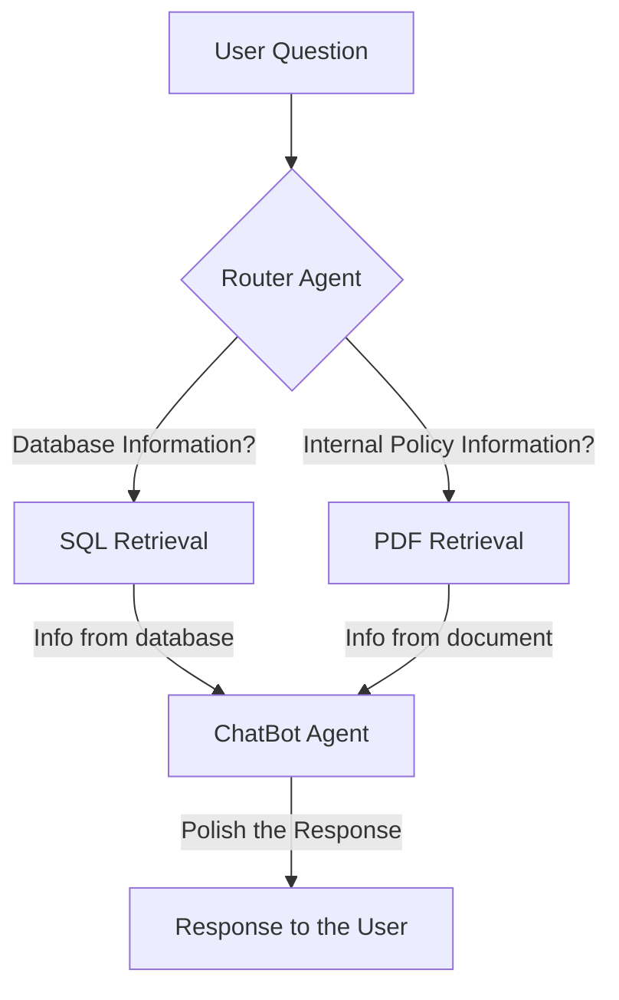
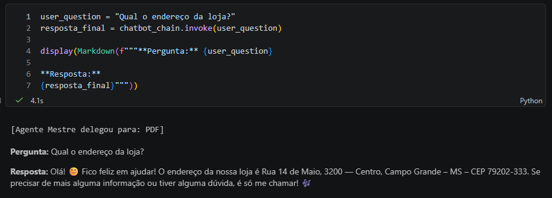
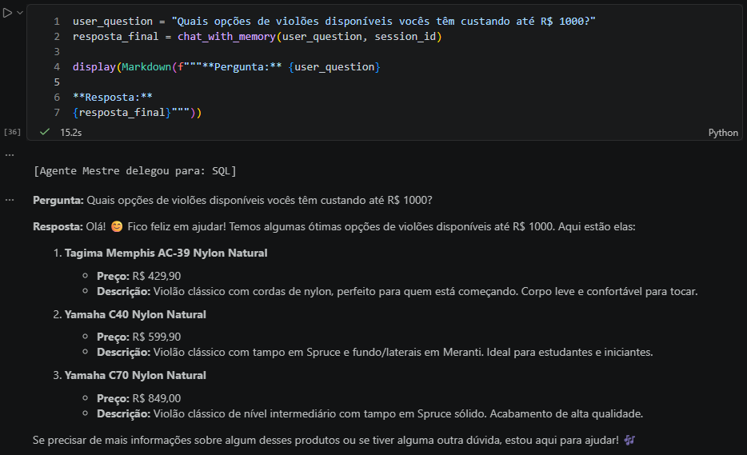
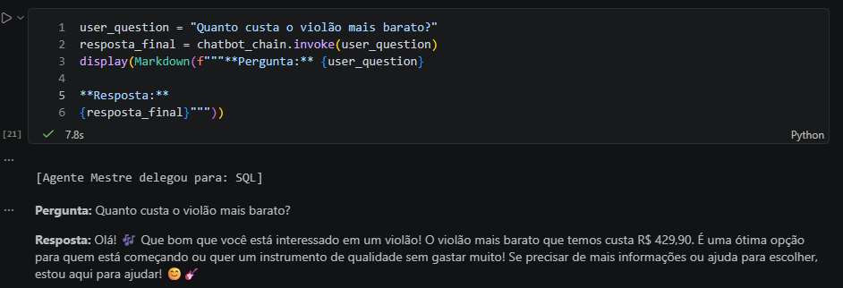
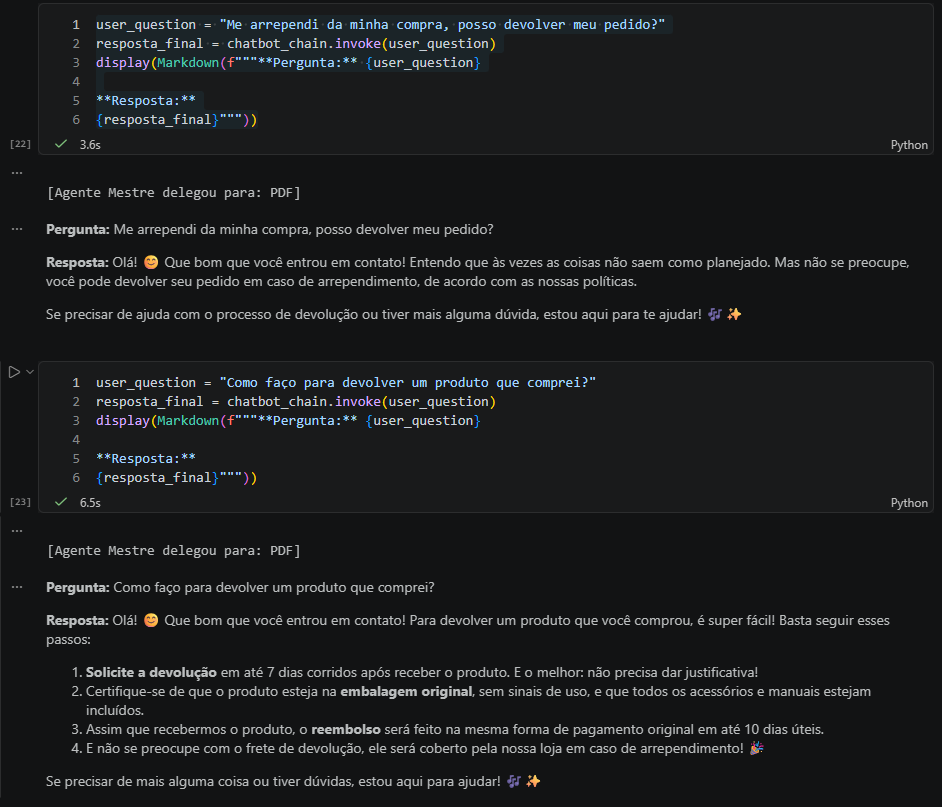
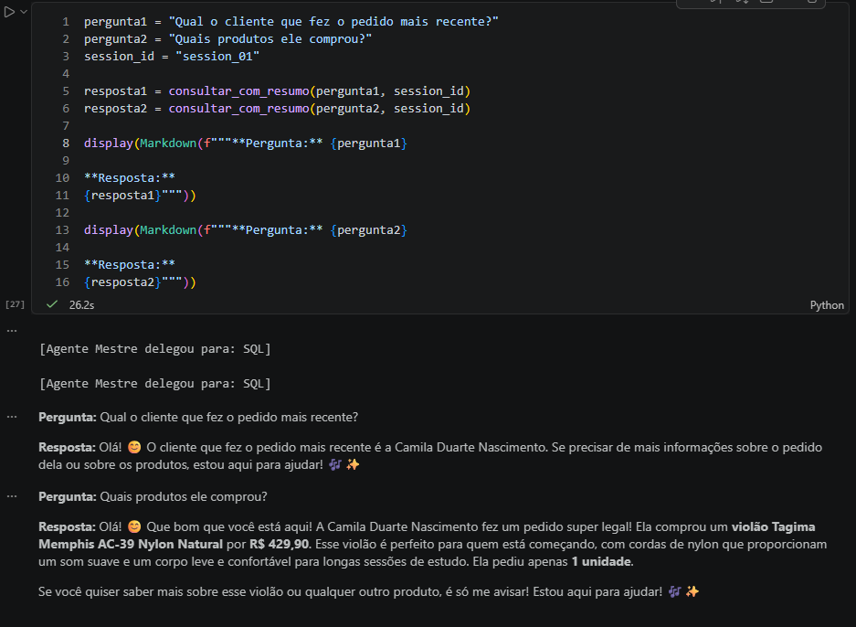

# Technical Challenge Artifact - AI Engineer 2026

Below is a flowchart representing how the project is structured regardind the flow of information:


##  Running the project:

Install the required packages:

```bash
uv pip install -r requirements.txt
```

Run `main.py` and interact through the CLI by asking questions.

## Development Process

I started developing in a Jupyter Notebook because it's easier to debug and analyse the code. After I tested, I chose to implement the code in Python files instead of Jupyter Notebooks to make it more modular.

At first I was running LM Studio with `Qwen 3.5 - 9b` locally, but then I had to switch to OpenAI API (`gpt-4o-mini`) instead of local models because semantic search is more powerful than running locally and I was getting some unwanted results with local models. For example the local model could not find the address when I asked in a slightly different expression ("Onde fica a loja física?" - "Where is the physical store?").

The instructions for the retrievers were refined iteratively when I encountered significant errors. For example the SQL Agent kept considering `ukuleles` as `acoutic guitars`, but then when I asked which `ukuleleles` were available, the model could not find any. After some tweaks to the prompt I managed to make the retriever work.


I used Gemini's help to guide me through this challenge, specially for code syntax, troubleshooting local AI models and overall guidance. I also referred to a [deeplearning.ai course on Retrieval Augmented Generation](https://www.deeplearning.ai/courses/retrieval-augmented-generation).

If I had more time I'd improve the Prompts Guidelines for the agents as well as elaborate some Guardrails to prevent unwanted private or sensitive data to be retrieved by anyone.


## Examples

Screenshots of interaction examples in Jupyter Notebook environment.

### Store Address


### Acoustic guitar cheaper than R$ 1000


### Cheapest acoustic guitar


### Return policy


### Chat with memory summary from previous turns
